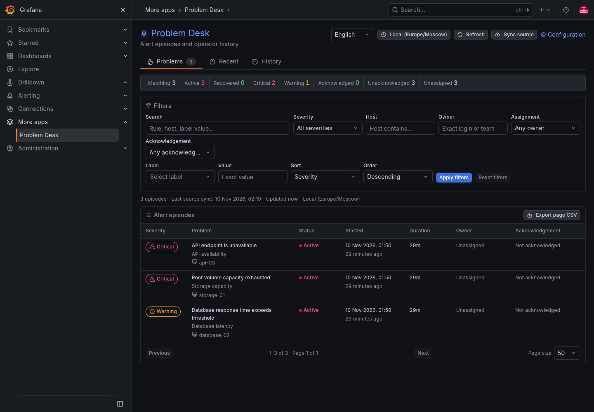

<p align="center"></p>

# Problem Desk for Grafana

[](https://github.com/mlimarenko/grafana-problem-desk/releases)
[](LICENSE)

Problem Desk is an app plugin for working with problem episodes from Grafana Alerting. It brings acknowledgements and comments into Grafana, with persistent, organization-scoped records.



## What it adds

- Problems, Recent and History views with server-side filters and pagination
- Host, severity, acknowledgement, owner and label filters; time windows and duration sorting
- A discussion attached to a specific occurrence, not a point on a graph
- Acknowledgement, owner labels and an operator activity log
- Persistent SQLite storage, Grafana user attribution and organization isolation
- Grafana-native controls and a layout that also works on narrow screens
- English and Russian interface, with a remembered language preference

Problem Desk is an **organization-wide shared workspace**. It does not reproduce Grafana Alerting's per-folder permissions: alert data visible to its service account is shared with organization members through the plugin. Administrators must not enable it where this would expose restricted data. See [security](docs/en/SECURITY.md).

Problem Desk does not evaluate alert rules. Acknowledging a problem does not mute or resolve alerts; use Grafana Alerting's own controls for silences and notification routing.

## Installation

The minimum supported version is Grafana 13.3. The app plugin ID is `mlimarenko-problemdesk-app`. Public plugin signing is pending; an unsigned plugin should only be enabled explicitly in a trusted private development environment. See [installation](docs/en/INSTALL.md) before deploying.

For local development, install Node.js 22+ and the Go toolchain required by `go.mod`, then:

```sh
git clone https://github.com/mlimarenko/grafana-problem-desk.git
cd grafana-problem-desk
cp .env.example .env
# Set a unique GRAFANA_ADMIN_PASSWORD in .env before starting Grafana.
make dev
```

Open `http://localhost:13010`, enable the app and configure a read-only service account token from the same Grafana organization. The [configuration guide](docs/en/CONFIGURATION.md) explains the visibility boundary. No demonstration alerts or customer configurations are installed automatically.

## Documentation

| Topic | English | Русский |
| --- | --- | --- |
| Overview | [Index](docs/en/README.md) | [Указатель](docs/ru/README.md) |
| Installation | [Install](docs/en/INSTALL.md) | [Установка](docs/ru/INSTALL.md) |
| Configuration | [Configuration](docs/en/CONFIGURATION.md) | [Настройка](docs/ru/CONFIGURATION.md) |
| Usage | [Usage](docs/en/USAGE.md) | [Работа](docs/ru/USAGE.md) |
| Development | [Development](docs/en/DEVELOPMENT.md) | [Разработка](docs/ru/DEVELOPMENT.md) |
| Security | [Security](docs/en/SECURITY.md) | [Безопасность](docs/ru/SECURITY.md) |

## Contributing and license

See [CONTRIBUTING.md](CONTRIBUTING.md), [SECURITY.md](SECURITY.md) and [CHANGELOG.md](CHANGELOG.md). Licensed under the [MIT License](LICENSE).

This is an independent project, not an official Grafana Labs product.
